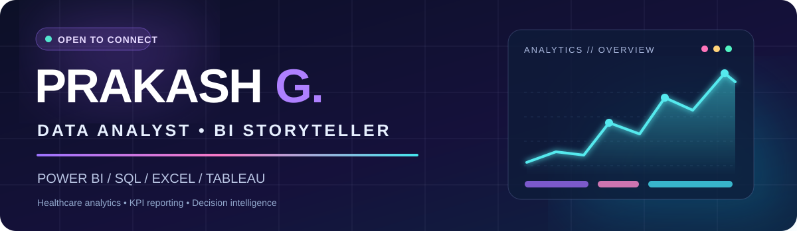

  
   
  
  

 

### 👋 Hello, I'm Prakash

I work at the intersection of **data, operations and decision-making**. I bring **4+ years of healthcare claims and operations experience** and practical analytics skills in **SQL, Power BI, Excel and Tableau**. My focus is turning messy operational data into clear KPIs, reliable reporting and useful business questions.

> **My approach:** Validate the data → ask the right question → analyze the drivers → explain the decision.

### ⚡ Analytics toolkit

### 🚀 Selected work

<table>
<tr>
<td width="50%" valign="top">
<h3>🩺 Healthcare Claims — SQL Analytics</h3>

<strong>SQL • Python utilities • Synthetic claims data</strong>

A project exploring claim approvals, denials, payment timelines and data quality with a relational healthcare dataset.

</td>
<td width="50%" valign="top">
<h3>🛒 E-Commerce Sales — Tableau</h3>

<strong>Tableau • KPI visualization • Sales analysis</strong>

An interactive workbook for exploring sales, profit, quantities, and region-level business performance.

</td>
</tr>
</table>

### 🎯 What I bring to a data team

| Analytical skill | Business application |
| :-- | :-- |
| **SQL** | Data extraction, joins, aggregates, CTEs, window functions and investigation |
| **Power BI + DAX** | KPI definition, data modeling, interactive reports and performance trends |
| **Advanced Excel** | Validation, PivotTables, lookups, reconciliation and operational reporting |
| **Healthcare domain** | Claims operations, data quality, exception handling and TAT/SLA awareness |
| **Communication** | Translating analysis into concise, stakeholder-friendly insights |

<strong>🧭 See how I approach an analytics problem</strong>

 

1. **Frame the question:** Define the business problem, users, KPIs and assumptions.
2. **Validate raw data:** Check keys, duplicates, blanks, dates and mismatches.
3. **Transform and model:** Use SQL, Power Query or Python where appropriate.
4. **Analyze:** Compare segments, trends and operational causes.
5. **Communicate:** Summarize findings, limitations and actionable next steps.

### 🌱 Currently exploring

Advanced Power BI modeling, deeper DAX patterns, Python for analytics and end-to-end portfolio projects.

### 🤝 Let's connect

I’m interested in connecting with analysts, BI developers, and hiring teams working on **Data Analyst, BI Analyst, Power BI and healthcare analytics** opportunities.

---

Built around real projects, practical skills and a continuous learning mindset.

<!--
**imalivehere1999-alt/imalivehere1999-alt** is a ✨ _special_ ✨ repository because its `README.md` (this file) appears on your GitHub profile.

Here are some ideas to get you started:

- 🔭 I’m currently working on ...
- 🌱 I’m currently learning ...
- 👯 I’m looking to collaborate on ...
- 🤔 I’m looking for help with ...
- 💬 Ask me about ...
- 📫 How to reach me: ...
- 😄 Pronouns: ...
- ⚡ Fun fact: ...
-->
